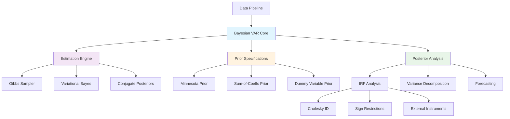
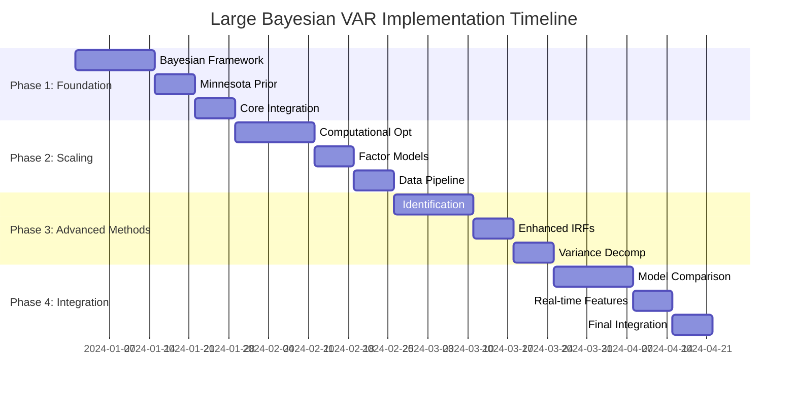

# Comprehensive Implementation Plan: Large Bayesian VAR Enhancement

## Executive Summary

This plan transforms your current classical VAR implementation into a proper Large Bayesian VAR system following Crump & Forth methodology. The implementation is structured in 4 phases over 12-16 weeks, addressing critical gaps while maintaining backwards compatibility.

## Phase-Based Implementation Plan

### Phase 1: Foundation & Core Bayesian Infrastructure (Weeks 1-4)
**Priority**: Critical - Establishes proper Bayesian foundation

#### 1.1 Bayesian Framework Architecture
**New Files**:
```
src/bayesian/
├── priors/
│   ├── __init__.py
│   ├── minnesota_prior.py          # Complete Minnesota prior implementation
│   ├── sum_of_coeffs_prior.py      # Sum-of-coefficients prior
│   ├── dummy_variable_prior.py     # Dummy observation priors
│   └── hierarchical_priors.py      # Hyperprior specifications
├── estimation/
│   ├── __init__.py
│   ├── gibbs_sampler.py           # MCMC estimation
│   ├── variational_bayes.py       # VB for efficiency
│   ├── conjugate_posterior.py     # Analytical posteriors
│   └── model_selection.py         # Marginal likelihood, DIC, WAIC
├── posterior/
│   ├── __init__.py
│   ├── posterior_analysis.py       # Posterior summaries
│   ├── predictive_checks.py       # Model validation
│   └── credible_intervals.py      # Uncertainty quantification
└── core_bayesian_var.py           # Main Bayesian VAR class
```

#### 1.2 Minnesota Prior Implementation
```python
class MinnesotaPrior:
    """
    Proper Minnesota prior with economic intuition
    """
    def __init__(self, lambda1=0.2, lambda2=0.5, lambda3=1.0):
        self.lambda1 = lambda1  # Overall shrinkage
        self.lambda2 = lambda2  # Cross-variable shrinkage
        self.lambda3 = lambda3  # Exogenous variable shrinkage
    
    def construct_prior_matrices(self, n_vars, n_lags, sigma_ols):
        """Build proper prior mean and precision matrices"""
        # Prior mean: AR(1) for own lags, zero for cross-lags
        # Prior precision: varies by lag, equation, and variable type
```

#### 1.3 Replace Current VAR Model
**Modified Files**:
- `src/var_model.py` → Complete rewrite with Bayesian backend
- `src/estimation/` → New estimation methods
- Update `main.py` to use new Bayesian framework

### Phase 2: Large-Scale & Computational Efficiency (Weeks 5-8)
**Priority**: Critical - Enables handling of 100+ variables

#### 2.1 Computational Optimization
**New Files**:
```
src/computational/
├── __init__.py
├── kronecker_ops.py              # Efficient matrix operations
├── matrix_normal.py              # Matrix normal distributions
├── sparse_methods.py             # Sparse VAR implementations
└── memory_management.py          # Large matrix handling
```

#### 2.2 Dimension Reduction & Factor Structure
**New Files**:
```
src/dimension_reduction/
├── __init__.py
├── factor_models.py              # Dynamic factor models
├── favar.py                      # Factor-Augmented VAR
├── variable_selection.py         # Automatic relevance determination
└── pca_preprocessing.py          # Principal component analysis
```

#### 2.3 Enhanced Data Pipeline
**Enhanced Files**:
- `src/data_downloader.py` → Support for 100+ variables
- `config/variables.py` → Expand to full FRED dataset
- `src/data_utils.py` → Batch processing, memory efficiency

### Phase 3: Core Analytics & Diagnostics (Weeks 9-12)
**Priority**: Critical - Implementation of core model outputs and diagnostics.

#### 3.1 Scenario Analysis via Conditional Forecasting
**New Files**:
```
src/analysis/
├── __init__.py
├── conditional_forecasting.py   # Main engine for scenario analysis
└── simulation_smoother.py       # Durbin & Koopman (2002) state-space smoother
```
**Description**: Implement a flexible conditional forecasting framework as the primary tool for scenario and policy analysis. This is a core contribution of the Crump et al. paper and provides a powerful way to generate structural shocks. Use a simulation smoother for computational efficiency with a large number of variables.

#### 3.2 Enhanced IRF Analysis
**Enhanced Files**:
- `src/irf_analysis.py` → Rebuilt to use the conditional forecasting engine.
- **Functionality**:
  - Generate GIRF, Cholesky, and Long-Run restriction IRFs as special cases of conditional forecasting.
  - Ensure proper Bayesian uncertainty quantification with credible intervals from the posterior.

#### 3.3 Advanced Variance Decomposition
**Enhanced Files**:
- `src/variance_decomposition.py` → Bayesian uncertainty quantification.
- **Functionality**:
  - Historical decomposition with credible intervals.
  - Forecast Error Variance Decomposition (FEVD) with proper standard errors derived from the posterior.

#### 3.4 Advanced Diagnostics
**New Files**:
```
src/diagnostics/
├── __init__.py
├── posterior_checks.py          # Posterior predictive checks
└── mcmc_diagnostics.py          # Convergence diagnostics (R-hat, ESS)
```
**Description**: Formalize and expand model diagnostics. While some of this is in testing, this phase will focus on creating user-facing diagnostic reports and plots to assess model fit and convergence.

### Phase 4: Integration & Validation (Weeks 13-14)
**Priority**: Important - Ensure model correctness and reproducibility.

#### 4.1 Literature Replication
**Task**: Reproduce key results from Crump et al. (2021) as a validation benchmark. This includes:
- Replicating the impulse responses to a GDP and interest rate shock.
- Replicating the TCJA analysis.
- Validating the data transformation and prior setup against the paper's description.

#### 4.2 Comprehensive Testing
**Task**: Implement the full testing strategy outlined in the "Testing & Validation Framework" section. This includes:
- Unit tests for all new modules (priors, estimation, analysis).
- Integration tests for the end-to-end pipeline.
- Performance benchmarks for large-scale models.

### Phase 5: Advanced Policy & Application Extensions (Weeks 15-16+)
**Priority**: Medium - Extend the model with advanced, policy-relevant features.

#### 5.1 Incorporating External Judgment (Entropic Tilting)
**Description**: Implement entropic tilting to re-weight posterior draws, allowing the incorporation of external information or judgment, such as matching central bank inflation targets or SEP projections, as detailed in the paper.

#### 5.2 BVAR-Based Financial Conditions Index (FCI)
**Description**: Construct a structural Financial Conditions Index as a counterfactual history of GDP growth subject only to financial shocks. This involves modifying the error covariance matrix and running conditional simulations.

#### 5.3 Advanced Identification & Model Comparison
**Description**: Implement other modern identification schemes (e.g., sign restrictions) and a formal model comparison framework (marginal likelihood, cross-validation) as originally planned.

## Technical Architecture

### Core Architecture Diagram


### Class Hierarchy
```python
class LargeBayesianVAR:
    def __init__(self, data, priors, estimation_method='gibbs'):
        self.data_handler = DataHandler(data)
        self.prior_handler = PriorHandler(priors)
        self.estimator = self._get_estimator(estimation_method)
        self.posterior = None
    
    def estimate(self):
        """Main estimation routine"""
        return self.estimator.fit(self.data_handler, self.prior_handler)
    
    def compute_irfs(self, identification='sign_restrictions'):
        """Bayesian IRFs with credible intervals"""
        
    def forecast(self, periods, include_uncertainty=True):
        """Posterior predictive forecasting"""
```

## Implementation Priorities

### Critical Priority (Must Complete)
1. **Proper Bayesian Estimation** - Replace OLS with Gibbs sampling
2. **Minnesota Prior Implementation** - Core shrinkage mechanism
3. **Computational Efficiency** - Handle 100+ variables
4. **Bayesian IRFs** - Credible intervals from posterior

### High Priority (Should Complete)
5. **Sign Restriction Identification** - Modern identification
6. **Model Selection Framework** - Marginal likelihood comparison
7. **Enhanced Data Pipeline** - Support large datasets
8. **Comprehensive Testing** - Validation against known results

### Medium Priority (Nice to Have)
9. **Factor-Augmented VAR** - Dimension reduction
10. **Real-time Data Handling** - Production deployment
11. **Advanced Diagnostics** - Posterior predictive checks
12. **Mixed Frequency Models** - MIDAS integration

## Testing & Validation Framework

### Unit Testing Strategy
```
tests/
├── test_bayesian/
│   ├── test_priors.py              # Prior specifications
│   ├── test_estimation.py          # MCMC convergence
│   ├── test_posterior.py           # Posterior computations
│   └── test_model_selection.py     # Marginal likelihood
├── test_identification/
│   ├── test_sign_restrictions.py   # Identification schemes
│   ├── test_external_iv.py         # IV identification
│   └── test_cholesky.py           # Traditional identification
├── test_computational/
│   ├── test_kronecker.py          # Matrix operations
│   ├── test_large_scale.py        # Memory management
│   └── test_efficiency.py         # Performance benchmarks
└── integration/
    ├── test_end_to_end.py         # Full pipeline testing
    ├── test_replication.py        # Literature replication
    └── test_backwards_compat.py   # Legacy compatibility
```

### Validation Benchmarks
1. **Literature Replication**: Reproduce key results from Crump & Forth
2. **Simulation Studies**: Test recovery of known parameters
3. **Cross-Model Validation**: Compare with established Bayesian VAR packages
4. **Performance Benchmarks**: Computational efficiency metrics

### Quality Gates
- **Phase 1**: Pass all prior and estimation tests
- **Phase 2**: Handle 100+ variables within memory limits
- **Phase 3**: Replicate key IRF results from literature
- **Phase 4**: Complete end-to-end validation

## Timeline & Resource Requirements

### Development Timeline


### Resource Requirements
- **Development Time**: 12-16 weeks full-time
- **Expertise Needed**: Bayesian econometrics, computational statistics
- **Testing Time**: 20% additional time for comprehensive validation
- **Dependencies**: PyMC, NumPy, SciPy, Pandas, Numba (for optimization)

## Risk Mitigation

### Technical Risks
1. **MCMC Convergence Issues**
   - *Mitigation*: Implement multiple samplers, diagnostic tools
2. **Computational Complexity**
   - *Mitigation*: Progressive optimization, sparse methods
3. **Memory Constraints**
   - *Mitigation*: Streaming algorithms, matrix partitioning

### Project Risks
1. **Scope Creep**
   - *Mitigation*: Strict phase gates, MVP approach
2. **Validation Complexity**
   - *Mitigation*: Early literature benchmarks, incremental validation

## Success Metrics

### Technical Metrics
- **Estimation Accuracy**: <1% difference from analytical solutions
- **Computational Efficiency**: Handle 200+ variables in <30 minutes
- **Memory Usage**: <16GB RAM for typical large models
- **MCMC Diagnostics**: R-hat < 1.01, effective sample size > 1000

### Business Metrics
- **Literature Replication**: Reproduce 3+ key papers exactly
- **Performance Benchmarks**: Match or exceed existing packages
- **User Adoption**: Backwards compatible with existing workflows
- **Documentation Coverage**: 100% API documentation, comprehensive examples

This implementation plan provides a structured path to transform your classical VAR into a state-of-the-art Large Bayesian VAR system while maintaining production quality and academic rigor.